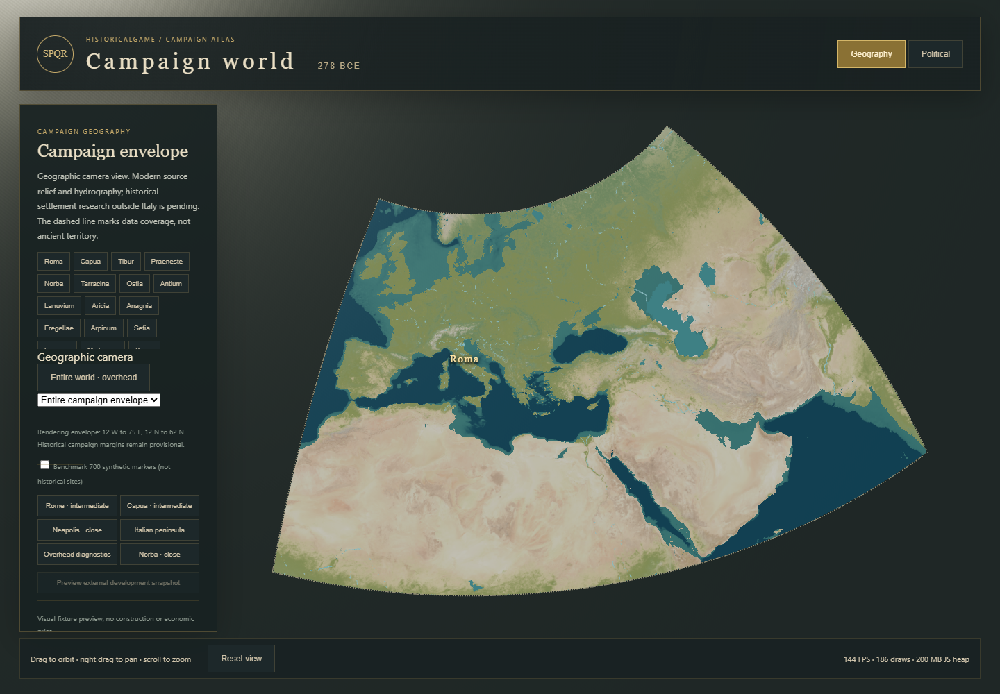

# VS5 continuous campaign geography foundation

Implementation and measured evidence, 2026-10-14. Continues checkpoint `5def230`;
retains TypeScript, Three.js, Vite, the deterministic simulation, and all 23 existing
settlement identities. No historical settlements, ownership, roads, institutions,
construction rules, or territorial borders were added outside the existing prototype.
Big Pickle's research and OPEN decisions, including AD-33, are unchanged by this work.

## Implemented coverage and unresolved campaign scope

The implemented **rendering/data envelope is exactly 12° W–75° E, 12° N–62° N**.
Its full extent is rendered from real sources. It is independent of the original Italy
crop and is **not an assertion of measured Rome II/DeI boundaries or approved playable
territory**. The existing scope proposal remains a proposal. The geographic envelope
can be changed by rebuilding the source catalog rather than relocating settlements.

| Edge | Implementation justification | Still unresolved |
| --- | --- | --- |
| 12° W | Atlantic margin west of Iberia, Ireland and the Moroccan coast | Final ocean buffer and playable Atlantic coastline |
| 62° N | Entire British Isles, northern European approaches and room north of Germania | How much Scandinavia or northern steppe is playable |
| 12° N | North Africa, Egypt, lower Nile/Nubian approaches and southern Arabian coverage buffer | Southern desert/Arabian and Nile campaign limits |
| 75° E | Includes the Iranian plateau, Bactrian and Kabul approaches, with an eastern buffer extending into the Indus/Punjab vicinity | Final eastern playable limit and content selection |

The official [Rome II Baktria description](https://r2encv2.totalwar.com/en/faction/rom_baktria/index.html)
supports an Afghan/Bactrian eastern reference, but supplies no georeferenced campaign
crop. Neither that entry nor screenshot proportions establish exact longitude limits.
No accessible georeferenced reference image establishes an agreed eastern edge here.
The chosen 75° E is therefore an explicit, reversible implementation boundary, not
closure of a historical scope or coordinate-system decision.

Visible in the continuous world: Iberia, British Isles, Gaul, Germania, Italy and its
islands, Balkans, Greece, North Africa, Egypt, Anatolia, Black Sea, Levant,
Mesopotamia, Iranian plateau and the eastern approaches through 75° E. All have coarse
source-based elevation/coastlines. These regions do **not** yet have the local terrain
resolution, researched settlement content, biomes or simulation geography of Italy.

The dashed outline marks source coverage. Outside it the background is darkened;
continental land cut by the northern/eastern/southern data boundary must not be read
as an invented coastline or an island edge.

## Sources, resolution and reproducibility

`scripts/import-world-geography.mjs` generates `public/data/world-terrain/`.
`manifest.json` records source URLs and SHA-256 hashes, regional output hashes,
coverage, detail-area selection, and limitations. Source downloads are cached in
ignored `data/geography/source-cache/`; source network access is unnecessary during play.
The generated world bundle is approximately 52 MB uncompressed on disk. It is not
all fetched or uploaded as detailed terrain at application startup.

| Layer | Source and rights | Implemented sampling |
| --- | --- | --- |
| World relief and bathymetry | [Mapzen Terrarium terrain tiles](https://github.com/tilezen/joerd/blob/master/docs/formats.md), hosted at `https://s3.amazonaws.com/elevation-tiles-prod/terrarium/6/{x}/{y}.png`; [original attribution and underlying licenses](https://github.com/tilezen/joerd/blob/master/docs/attribution.md) bundled verbatim | 221 z6 source PNGs; native pixels roughly 1.1–2.4 km across this latitude range; 513² overview lattice, approximately 9–19 km; 129² regional lattices, approximately 2–4.4 km |
| Coasts and major lakes | [GSHHG 2.3.7](https://www.soest.hawaii.edu/pwessel/gshhg/), high-resolution L1/L2; LGPL-3.0-or-later, notices and license texts bundled | Vector-derived 4097² overview shoreline mask (~1.1–2.4 km longitude spacing), 513² masks per five-degree tile (~0.5–1.1 km); selected lakes rendered separately |
| Major rivers | GSHHG WDBII high-resolution river classes 1 and 2, same archive/license | 603 world river segments, plus 149 existing Italian class 3–5 segments; modern alignments |
| Existing Italian terrain | Existing [Italy calibration pipeline](italy-geographic-calibration.md), Copernicus GLO-30 with its original notices | 85 one-degree regional grids (~650–870 m) and four city windows (~39–52 m); unchanged source files |
| Independent reference | [Natural Earth 5.1.1 1:10 million land](https://www.naturalearthdata.com/downloads/10m-physical-vectors/10m-land/), [public domain](https://www.naturalearthdata.com/about/terms-of-use/) | Validation only; not a replacement coastline or historical settlement database |

Terrarium decodes metres as `R*256 + G + B/256 - 32768`. Sampling uses Web Mercator
source pixel centers, bilinear interpolation and a shared WGS84 vertex lattice.
Five-degree tile bounds are clipped to the envelope; the final longitude column is
two degrees wide. Shared vertices use the same geographic sampling function, including
across the short final column. Ocean-only regional tiles are omitted; the complete
overview still covers their source-based ocean/bathymetry.

World ocean bathymetry is preserved separately from land display elevation. No
Copernicus zero-filled sea cells replace it. Display heights clamp below sea level
and use the existing **3× vertical exaggeration**, which is presentation only.
The Mapzen mosaic combines datasets/vertical references: it is not a uniform modern
survey, and source resolution is not a claim of equivalent horizontal or vertical
accuracy. Its ETOPO bathymetry is much coarser than local port geography.

There are 155 selected lake polygons, including retained smaller Italian lakes.
World lakes are selected with a bounding-box area threshold, **not** a measured lake
surface-area threshold. Lake display levels remain approximate. Modern reservoirs,
Aral/Caspian extents, deltas, river migration, Ostia's accretion, and ancient harbors
require research before being used as 278 BCE simulation geography. River clipping
keeps in-envelope source vertices and splits runs; exact crossing-point clipping at
the outer coverage boundary remains unfinished. Roads and territorial boundaries
were not fabricated to fill expanded coverage.

## Coordinates, camera and streaming

Authoritative place metadata remains WGS84 longitude/latitude in double precision.
The renderer retains the documented spherical azimuthal equidistant projection,
origin **13.5° E, 41.5° N**, earth radius 6,371,008.8 m, displayed in kilometres
(X east, Z negative north). The origin is a reference point, not an Italy-sized
world rectangle. Every region, tile, camera target and settlement uses this same
invertible transform and scene. No region switch creates a separate map.

This flat overview projection preserves distance from its origin, not every distance
or area. Its transverse scale reaches about **1.216 at 75° E, 12° N**. The curved
envelope edges and changed apparent orientation in the east reflect this projection.
Geographic source coordinates are unchanged. A future globe/ECEF or rebased regional
presentation can consume these same source coordinates; army distances should use
geographic distance/route data, not projected screenshot measurements. GPU positions
remain Float32; floating-origin work is still needed for metre-scale eastern local
detail. It is not needed to validate the current coarse regional views.

The world preset fits sampled geographic boundary curves into the unobstructed
viewport, with a north-up overhead camera. The camera selector provides Iberia,
Italy, Greece, Egypt, Anatolia, Mesopotamia and the eastern edge; the independent
**Entire world · overhead** button returns from any local settlement view. Travel
tweens the existing camera and target over 1.2 seconds. Drag/orbit, pan and continuous
zoom remain available, as do the original Italy/reset and settlement focus controls.

Streaming uses three physical detail families:

1. Above 6,000 km camera distance, the whole-world context remains visible and all
   regional GPU tiles are unloaded. The context uses its 129² coarse mesh above
   450 km, and the 513² mesh below it, sharing the same source lattice.
2. Regional views choose at most **12** of 176 five-degree land-bearing tiles,
   ranked by distance to the camera target; at most **three** loads are pending.
   Tile meshes use 129²/65²/33² interiors at distance thresholds 0/2,000/6,000 km.
3. Within the Italy detail area and below 1,400 km, the existing regional/city family
   replaces the world regional family. Its original 0/260/550 km LOD thresholds and
   city visualization remain available. Seven existing CPU terrain grids remain
   preloaded for stable city placement; all 89 Italian grids are not loaded together.

Eviction disposes geometry, shore textures and materials. Stale asynchronous responses
are discarded if no longer wanted. The overview fills every nonresident area while
loading. Mixed LOD meshes retain every edge vertex, adjacent source heights/masks
are exact, and exposed regional edges blend to the active context triangles, normals
and colors. The blend now handles variable tile spans rather than assuming one degree.
Within a regional grid, tile edges have no source discontinuity. Differences between
overview and detailed relief can still produce visible transition bands or pops;
continuous geomorphing/quadtree refinement and improved DEM blending remain work.
The cache is distance-ranked rather than a production screen-error/frustum scheduler.

Rivers are batched into one segmented draw instead of one draw per feature. Lakes
retain individual meshes and account for much of the overview draw count; batching
them remains a straightforward optimization. Existing instancing, culling,
settlement LOD and label collision handling are retained.

## Settlement scalability and simulation boundary

All **23** rendered historical place records, their canonical IDs and their source
coordinates are unchanged. The existing Neapolis presentation anchor remains separate
from its gazetteer coordinate. Existing control read models and development-driven
asset eligibility/selection continue to work; political tinting is restricted to
the existing researched/prototype area rather than painting the world with nearest
Italian factions. No expanded-world political ownership was invented.

The new benchmark uses **700 synthetic entities**, plus **1,000** as growth headroom
(approximately 43%). The dedicated pure geographic bucket index culls by bounds;
the renderer draws markers with a single instanced mesh. Fixtures have
`synthetic-only:` IDs and `synthetic: true`, live outside the atlas/control maps,
and are disabled by default. Their evenly distributed coordinates deliberately
include water. They are performance fixtures, not candidate historical sites.

Use the benchmark checkbox for 700; the verifier also invokes
`window.__campaignMap.setSyntheticForValidation(true, 1000)` for headroom.
The configurable index/fixture API does not make 700 a simulation limit. A future
simulation read model can rebuild the index on revisions when settlements are
founded, abandoned, destroyed or change importance. Research selects historically
significant starting sites; supporting farms/estates/mines need not become settlement
entities. This work neither closes AD-33 nor creates a new authoritative settlement
development or lifecycle contract.

These tests demonstrate geographic indexing, culling and cheap marker rendering.
They do **not** measure 700 detailed cities, 700 labels, economic systems or agent
simulation. Dense zoom-dependent historical labeling and asset streaming still need
validation against the eventual researched distribution.

## Validation and measurements

`npm run validate` passes typecheck, lint, **371 tests in 24 files**, simulation build
and build smoke checks. The checkpoint's 351 tests remain, with 20 world tests added.
`npm run map:build` passes; Vite still warns about the approximately 652 kB main chunk.
This warning is reported rather than suppressed.

`npm run map:validate:world` compares modern GSHHG rendering coverage to independently
downloaded Natural Earth polygons: **26 broad landmarks and 1,024 stable grid samples
agree**. Forty-three near-coast samples and eight inland-water semantics differences
are explicitly excluded and enumerated. For example, Natural Earth's land layer
includes several inland lake areas that the separate GSHHG lake layer covers with
water. The Caspian is checked as visible inland water, not assumed to be land merely
because its underlying continental land mask is true. This is sparse modern
cartographic QA, not proof of ancient shoreline or metre-scale survey accuracy.
The [independent audit](world-evidence/independent-geography.json) records source hash,
sample coordinates, exclusions and zero remaining mismatches.

Automated tests also validate every world tile's source/shape/hash, exact shared
elevations and shoreline bits, regional projection round-trips, broad elevation
sanity checks, context/Italy/world detail selection, retention of all original places,
and deterministic 700/1,000-entity indexed queries against brute-force results.

The [production browser run](world-evidence/metrics.json) traverses all seven region
presets, checks that the actual Three.js scene UUID stays the same, verifies full
envelope edges fit the viewport, tile loading/eviction and return to world scale,
700/1,000 instanced marker counts, local Rome and political rendering, and unchanged
settlement coordinates/control state. No geographic asset requests fail and no
uncaught browser errors occur. Regional tiles never exceed twelve residents.

Measured environment: Windows, i7-11800H, approximately 16 GB RAM, RTX 3060 Laptop
GPU through ANGLE/D3D11, headless Chrome 155.0.8059.40, 1440×1000, production Vite
preview. World-ready time **2.49 s**. Three-second idle samples:

| View | Mean FPS | Draw calls | Triangles | JS heap MiB |
| --- | ---: | ---: | ---: | ---: |
| World | 143.6 | 186 | 293,315 | 116 |
| Iberia | 143.9 | 20 | 426,325 | 188 |
| Italy | 143.9 | 90 | 302,795 | 197 |
| Greece | 143.6 | 29 | 661,791 | 185 |
| Egypt | 143.9 | 17 | 426,890 | 183 |
| Anatolia | 143.9 | 21 | 428,709 | 177 |
| Mesopotamia | 143.9 | 25 | 429,949 | 182 |
| Eastern edge | 142.6 | 20 | 358,258 | 179 |
| World + 700 synthetic markers | 142.9 | 187 | 298,915 | 194 |
| World + 1,000 synthetic markers | 143.2 | 187 | 301,315 | 142 |
| Local Rome | 143.9 | 55 | 678,256 | 183 |

P95 frame times were approximately 7.1 ms. The near-144 FPS plateau suggests the
environment's presentation cap; it is not evidence of unlimited capacity. Heap
differences include garbage collection and view history. The seven owned browser
processes measured approximately 1,054 MiB private memory and 1,117 MiB summed working
sets at the end; shared pages may be counted twice. Reliable GPU VRAM measurement
was unavailable. These are short idle-view samples, not a long-run camera, low-end
hardware or complete campaign stress test.

### Legacy verifier investigation

The retained `map:verify` initially failed at the Roma raycast assertion. It clicked
the old label-derived screen position (`label point + 10 px`), which is not the new
architectural hit sphere. After explicitly resetting to the Italy fixture, the click
selected terrain rather than Roma. The verifier now projects the settlement's source
coordinate (Neapolis uses its documented presentation anchor), keeping its actual
canvas raycast assertion. A reset at startup accommodates the new world default.
No meaningful assertion was removed or retired: settlement/region picking, political
control transfer, zoom/reset, far LOD, tier labels and collision checks remain.
The legacy script passes on the production build, as does `map:verify:italy`.
Retained run results: [legacy assertions](world-evidence/legacy-regression.json)
and [Italy regression assertions](world-evidence/italy-regression.json).

## Evidence and running the map



| Regional evidence | Regional evidence |
| --- | --- |
| [Iberia](world-evidence/iberia.png) | [Italy](world-evidence/italy.png) |
| [Greece](world-evidence/greece.png) | [Egypt](world-evidence/egypt.png) |
| [Anatolia](world-evidence/anatolia.png) | [Mesopotamia](world-evidence/mesopotamia.png) |
| [Eastern edge](world-evidence/east.png) | [Local Rome](world-evidence/rome-local.png) |
| [700 synthetic markers](world-evidence/synthetic-700.png) | [1,000 growth headroom](world-evidence/synthetic-1000.png) |
| [Local political mode](world-evidence/italy-political-local.png) | [Browser metrics and assertions](world-evidence/metrics.json) |

```sh
npm install
npm run map:dev
```

Use the geographic camera selector or Entire world button. Pan/orbit/zoom within the
same scene. Italy focus buttons retain local settlement inspection. Reset restores
the original Italy camera for comparison.

The committed bundle works offline after dependencies are installed. To regenerate:

```sh
npm run map:terrain              # existing Italy pipeline, needed if absent/changed
npm run map:world                # coarse world sources + retained Italy references
npm run map:validate:world       # independent reference download/cache; modern QA
npm run map:validate:geography   # existing Italian independent validation
npm run validate
npm run map:build
npm run map:preview -- --port 4173
```

With preview running, in another terminal:

```sh
npm run map:verify:world
npm run map:verify:italy -- http://127.0.0.1:4173 .runtime/world-italy-regression
npm run map:verify -- http://127.0.0.1:4173 .runtime/world-legacy-regression
```

Browser scripts use installed Chrome via Playwright's `channel: 'chrome'`. Regeneration
requires source network access unless cached. It uses four concurrent source fetches;
a failed source download fails the import rather than filling invented terrain.

## Remaining work

The full technical envelope is covered and navigable at overview/regional resolution.
It is **not** a finished campaign world or premium historical landscape. Expanded
regions still need selective finer DEMs, historical river/coastline corrections and
survey QA. The reused altitude palette makes deserts green; it is not a land-cover,
ancient vegetation or climate dataset. This known visual/geographic presentation gap
needs sourced biome/aridity materials, rather than speculative vegetation placement.
Lake levels, source-family transition bands, coarse shoreline stair-stepping, and
projection distortion remain visible limitations.

Next foundation work: calibrate the final historical/playable envelope; add selective
screen-error-driven refinement and transition morphing; validate longer navigation
and network-failure recovery; stream/cull vector features; prepare floating origins
for local eastern detail; consume researched settlements and future simulation read
models without binding geographic identity to political control. Global settlement
research, army routefinding, historical boundaries, tactical terrain generation and
continuous-zoom formations remain outside this implementation.
