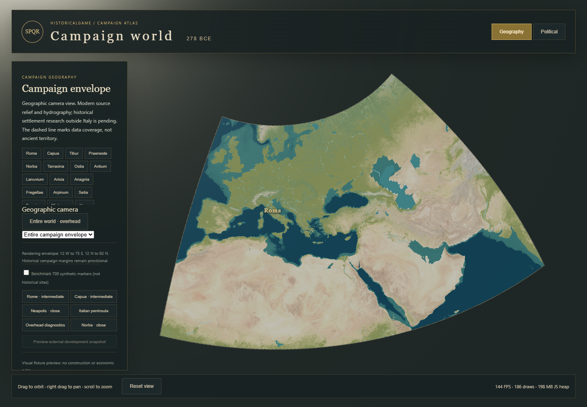

# VS5 regional terrain identity and continuous zoom

Implemented 2026-10-14 on the existing continuous Three.js campaign map. Rendering
coverage remains **12° W–75° E, 12° N–62° N**, with the same provisional playable
margins, terrain sources, projection and 23 settlement coordinates/IDs. No historical
settlements, political borders, roads, simulation mechanics or city assets were added.
Big Pickle's research and OPEN architectural decisions were not changed. No Git
operations, commits or pushes were performed for this milestone.

## Visible result

The shared elevation-only green ramp has been replaced by one geographically sampled
land-cover material field. Sahara, Egypt and Arabia now have sandy/bare-rock material;
the Nile valley and delta remain visibly vegetated. Mediterranean environments,
temperate vegetation, steppe, mountain surfaces and transitional areas retain their
source's spatial variation. This is not a set of latitude bands or painted regional
rectangles. Existing water, coastlines, relief and settlement architecture remain 3D.

The full-world camera still shows the entire envelope. A North Africa preset was
added. The Egypt preset now centers on 30.5° E, 28° N at 1,800 km camera distance so
the delta is visible below the header. Other regional and local navigation remains
in the same scene. Original screenshots are preserved in `world-evidence/`;
current evidence is in `regional-terrain-evidence/`.



| Before | Current |
| --- | --- |
| [Green Sahara/world baseline](world-evidence/world-overhead.png) | [World with ecological materials](regional-terrain-evidence/world-overhead.png) |
| [Egypt baseline](world-evidence/egypt.png) | [Egypt and the Nile delta](regional-terrain-evidence/egypt.png) |
| [Iberia baseline](world-evidence/iberia.png) | [Iberia](regional-terrain-evidence/iberia.png) |
| [Greece baseline](world-evidence/greece.png) | [Greece](regional-terrain-evidence/greece.png) |
| [Anatolia baseline](world-evidence/anatolia.png) | [Anatolia](regional-terrain-evidence/anatolia.png) |
| [Rome baseline](world-evidence/rome-local.png) | [Rome local](regional-terrain-evidence/rome-local.png) |

Additional views: [North Africa](regional-terrain-evidence/north-africa.png),
[Nile corridor](regional-terrain-evidence/nile-corridor.png),
[Rome intermediate](regional-terrain-evidence/rome-intermediate.png),
[political-mode regression](regional-terrain-evidence/italy-political-local.png).
World/Iberia/Greece/Anatolia use the prior camera presets; Egypt is deliberately
reframed to expose the delta. Screenshot comparisons are visual evidence, not a
pixel-for-pixel geography survey.

## Source evidence and historical limits

Two sources are cropped by `scripts/import-regional-ecology.mjs`:

| Source | Role | Rights and resolution |
| --- | --- | --- |
| [Natural Earth I, unshaded land-cover coloring](https://www.naturalearthdata.com/downloads/10m-raster-data/10m-natural-earth-1/), v3.2.0, `NE1_LR_LC` | Satellite-derived cartographic RGB supplies the spatial material variation | [Public domain](https://www.naturalearthdata.com/about/terms-of-use/). Source 16,200×8,100, 0.022222…° pixels, approximately 2.47 km north–south. This is cartographic scale/spacing, not thematic accuracy. |
| [Beck et al., Scientific Data 10, 724 (2023)](https://doi.org/10.1038/s41597-023-02549-6), Köppen-Geiger classes for **1991–2020** | Categorical modern climate evidence and diagnostics: desert, steppe, dry-summer temperate, other temperate, continental and polar families | [CC BY 4.0 dataset](https://figshare.com/articles/dataset/21789074), pinned archive file `45057352`, selected `1991_2020/koppen_geiger_0p00833333.tif`; native ~0.93 km latitude spacing. Nearest categorical samples are resampled onto the coarser material lattice. |

The full climate legend, Natural Earth README, citations and modification notice
ship with `public/data/regional-ecology/`. The manifest records exact URLs, archive
SHA-256 hashes, output hashes, resolution, resampling, categorical counts and ten
reference probes. The sources are cached outside the shipped bundle; their entire
global rasters are not loaded by the browser.

The generated 3,916×2,251 lattice covers the full envelope. RGB uses bilinear sampling;
categorical climate uses nearest-neighbor sampling, never interpolated class numbers.
First and last texel centers correspond to the envelope corners. The shader applies
half-texel correction. The combined PNGs occupy approximately 10.5 MB on disk.

Natural Earth provides **cartographic colors**, not a scientific categorical
forest/crop/soil map. To obtain usable terrain albedo from its pale reference palette,
a single documented global transfer applies gamma 1.24 and exposure 0.85, then
interprets its yellow/green chroma as a vegetation **tint** and blends at most 55%
toward an olive material. The exact formula is in the importer. This artistic signal
is not canopy percentage, crop coverage, productivity or historical evidence. No
latitude condition, hand-drawn biome boundary or green river-distance buffer is used.
High terrain receives a modest rock-material blend from the existing physical DEM;
the unchanged 3× display exaggeration is accounted for in that blend.

The distinction matters at the Nile: the source already contains the corridor/delta
pattern, and the material grade makes it readable. It does **not** establish the
extent, fertility or crop type of the 278 BCE floodplain. Modern irrigation,
agriculture, Aswan-related changes, urbanization and source generalization can affect
these colors. Neither modern climate classes nor modern satellite land cover prove
ancient vegetation. There is no asserted reconstruction of ancient forests, wetlands,
shorelines, seasonal water, fields or resource production.

Köppen classes are explicitly labeled modern. For example, the selected Iberian
interior probe is modern BSk steppe, while the Greek probe is Csa and central European
probe Cfb. An entire named region is never forced into one assumed biome. Climate
classes are available to validation and future presentation, but do not set yields,
movement, political state, development or simulation rules.

## Continuous material and terrain transitions

`map/regional-material.js` samples the material in the fragment shader by inversely
projecting actual world X/Z coordinates to longitude/latitude. Overview, regional,
city and political-overlay materials share this function and the same texture. Thus
material detail does not change with mesh vertex density, and a five-degree tile
does not carry a separately stretched image or a different palette. Existing political
vertex tinting still multiplies the physical material from the simulation read model.

Geometry transitions now use parent-triangle position and normal interpolation:

- Regional topology retains every perimeter vertex at each LOD. Cached interpolation
  weights sample the actual coarser fan triangles, rather than assuming a different
  diagonal or a flat parent surface.
- GPU morphing begins at 76% of the next LOD distance and completes at 92%, before
  the existing hysteretic switch in either direction. The underlying switch distances
  and bounded residency remain intact.
- The world overview also morphs its 513² mesh toward the actual 129² plane topology,
  including its different diagonal orientation.
- New resident tiles rise from the current context surface over 650 ms using a smooth
  reveal, including normal blending. Parent attributes are refreshed when neighboring
  coverage or context LOD changes. Neighborhood signatures avoid redundant rebuilds;
  initial reveal samples are computed once per geometry.
- Context cutouts use inverse-projected geographic coordinates, avoiding misaligned
  holes from coarse UV interpolation. Small underlaps (0.00005° for context and
  0.00003° at city cutouts, a few metres) plus depth priority close precision cracks.
  These are rendering tolerances; settlement and terrain source coordinates do not move.

No additional transition meshes or terrain draw passes are needed. The cap remains
12 resident tiles and three pending loads. Detail is still unloaded at world scale.
The material is one shared ~44.8 MiB RGBA texture including mipmaps by size estimate;
the CPU climate index is ~8.4 MiB. These are estimates, not measured GPU VRAM.

This reduces visible popping and rectangular material seams; it is not a complete
screen-error-driven continuous terrain system. Source-family replacement and eviction
can still change relief abruptly during rapid navigation. Remaining normal/surface
differences, boundary precision and coastline aliasing deserve further work. No
regional heightmap resolution was increased during this milestone.

## Validation and source gaps

`npm run validate` passes typecheck, lint, **393 tests in 25 files**, the TypeScript
simulation build and smoke checks. The prior 371 tests remain; the new North Africa
preset extends existing geographic tests and 21 focused ecology/transition tests were
added. These check source/output integrity, envelope and texel-center mapping, every
climate family, rejection of invalid/no-coverage queries, parent interpolation,
nonlinear perimeter retention, regular overview diagonals, and bounded smooth morphs.

`npm run map:validate:ecology` additionally decodes all **8,814,916** output pixels,
validates class codes/opacity/counts/hashes, checks ten source probes and tests that
the Nile material remains distinct from adjacent western desert. Of 204,992 coarse
GSHHG continental-mask samples, **333** have no climate class (~0.16%). They are
enumerated in [the coverage report](../../data/geography/regional-ecology-validation.json).
The continental mask includes inland water, and source coast/lake generalization
differs: these are unclassified samples, not automatically continental source holes.
No desert or other class is fabricated for them. Full RGB coverage is not a claim of
thematic or ancient accuracy.

The [regional production-browser validation](regional-terrain-evidence/regional-validation.json)
exercises the existing world verifier first, then North Africa, Nile, ten runtime
climate probes, camera zoom through 6,500/5,800/2,600/2,050/1,950/1,000/500/430/390 km,
and Rome. Scene identity, 23 settlement identities/coordinates and political read
models remain unchanged. Terrain remains bounded, reveal completes, and no missing
geographic assets, shader errors or uncaught browser errors occur. The existing
700-entity benchmark and 1,000-entity headroom remain synthetic and separate from
the historical atlas. Both the full [Italy interaction/development regression](regional-terrain-evidence/italy-regression.json)
and [legacy selection/zoom/LOD regression](regional-terrain-evidence/legacy-regression.json)
pass on the final production build. No meaningful existing assertion was removed.

### Performance

The detailed [world/regional measurements](regional-terrain-evidence/metrics.json)
and [North Africa/Rome measurements](regional-terrain-evidence/regional-validation.json)
record three-second idle samples in production preview, headless Chrome,
1440×1000, Windows, i7-11800H, RTX 3060 Laptop GPU through ANGLE/D3D11, ~16 GB RAM.

<!-- PERFORMANCE_TABLE -->
| View | Mean FPS | Draw calls | Triangles | JS heap MiB |
| --- | ---: | ---: | ---: | ---: |
| World | 139.6 | 186 | 293,315 | 196 |
| North Africa | 143.9 | 20 | 375,731 | 235 |
| Egypt | 143.9 | 18 | 260,293 | 288 |
| Iberia | 143.9 | 20 | 426,325 | 226 |
| Greece | 143.6 | 29 | 661,791 | 244 |
| Anatolia | 143.9 | 21 | 428,709 | 266 |
| Rome local | 143.9 | 55 | 678,256 | 227 |
| Rome intermediate | 143.9 | 55 | 678,256 | 246 |
| World + 700 synthetic markers | 142.6 | 187 | 298,915 | 219 |
| World + 1,000 headroom | 143.9 | 187 | 301,315 | 220 |

World ready: 3.02 s. P95 idle frame times: approximately 7.1 ms.
Owned browser process private memory: 1253 MiB; summed working sets: 1381 MiB across 7 processes.
<!-- /PERFORMANCE_TABLE -->

FPS near 144 reflects this environment's presentation cap; it is not proof of
unlimited headroom. JS heap depends on GC and navigation history. The material and
morph attributes increase memory relative to the elevation-ramp baseline. Measured
browser-process memory includes more than the JS heap, and summed working sets can
double-count shared pages. Reliable GPU VRAM measurement is unavailable. These are
idle-view samples, not long-running low-end-hardware or campaign simulation tests.
Loading and shader compilation can still cause transient frame spikes; this report
does not claim stall-free terrain streaming.

## Running and next work

```sh
npm run map:dev
```

Use the existing camera selector, including North Africa/Egypt, then focus Rome or
zoom freely. The committed derivative data works without source network access.

```sh
npm run map:ecology             # reproduce the sourced material + climate index
npm run map:validate:ecology
npm run validate
npm run map:build
npm run map:preview -- --port 4173
```

With preview running in another terminal:

```sh
npm run map:verify:regional
npm run map:verify:italy -- http://127.0.0.1:4173 .runtime/ecology-italy-regression
npm run map:verify -- http://127.0.0.1:4173 .runtime/ecology-legacy-regression
```

Regeneration uses existing Node dependencies and cached upstream archives; initial
downloads require network access. A failed source request stops import rather than
painting invented coverage. Vite's existing main-chunk-size warning remains visible.

The result is a more geographically legible world with continuous source-based
materials, not a finished premium landscape. Next work should add independently
validated categorical vegetation/land-use evidence where needed, ancient ecological
research overlays, finer valley/coast materials, DEM/vector streaming and transition
refinement. Modern forests/agriculture must not silently become the 278 BCE world.
Historical biome corrections, seasonal systems, detailed city art, armies, roads,
new borders and economic rules remain outside this implementation.
