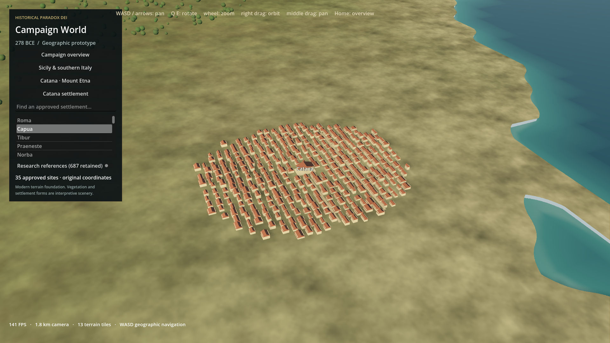
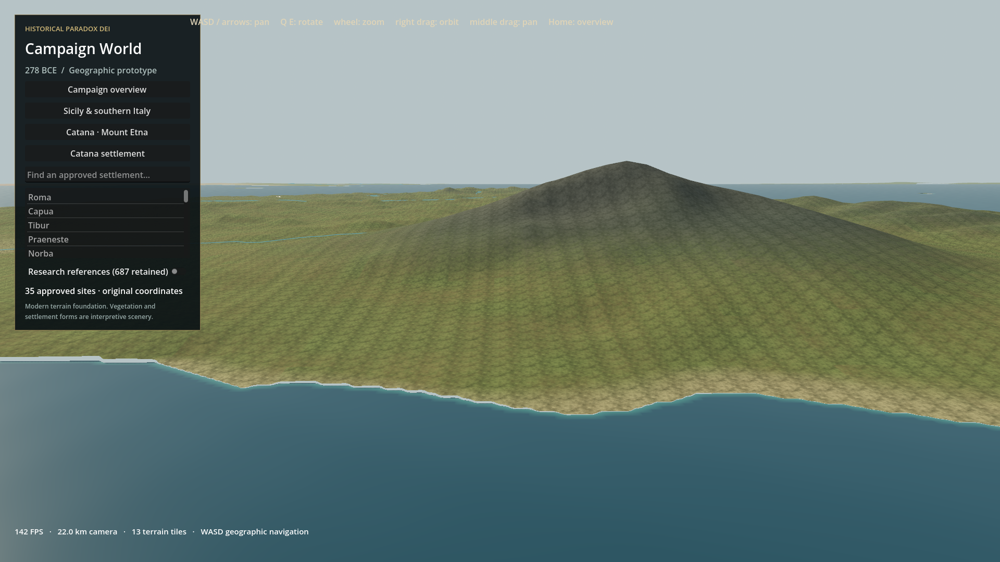

# Native campaign-world prototype: measured checkpoint

The separate Godot project works across the original campaign envelope and includes a detailed Catana environment. The renders show added local material variation, water shading, settlement geometry and atmosphere. **The intended large visual transformation is only partially achieved.** Etna remains smooth, vegetation is primitive, regional views remain close to the existing viewer, and terrain transitions still need work. Keep this as a working experiment; do not migrate the simulation or retire Three.js on this evidence.

## Actual rendered comparison

Every link below is an actual 1920×1080 capture, not concept art. Camera focus, pitch, yaw, distance and FOV are matched; interface layouts and rendering effects differ.

| View | Existing Three.js | Godot |
|---|---|---|
| overview | [Screenshot](evidence/three-overview.png) | [Screenshot](evidence/godot-overview.png) |
| sicily | [Screenshot](evidence/three-sicily.png) | [Screenshot](evidence/godot-sicily.png) |
| etna | [Screenshot](evidence/three-etna.png) | [Screenshot](evidence/godot-etna.png) |
| catana | [Screenshot](evidence/three-catana.png) | [Screenshot](evidence/godot-catana.png) |

Catana now has a recognizable three-dimensional settlement rather than only a terrain marker. Its architecture is an original generic interpretation, not an archaeological reconstruction. Etna uses the existing elevation samples, with an original volcanic material zone; the camera shows its silhouette without adding fictional elevation. The overview preserves geographic breadth, but it is not a visual breakthrough. Regional tiles still expose shading seams and coarse boundaries; the screenshots should be judged with those defects visible.

## Performance

Development machine: 11th Gen Intel(R) Core(TM) i7-11800H @ 2.30GHz; 15.8 GiB RAM; NVIDIA GeForce RTX 3060 Laptop GPU. Godot 4.7.2-stable (official), Forward+ / Vulkan.

| View | Godot average FPS | Godot p95 frame ms | Godot maximum sampled ms | Three average FPS | Three p95 ms | Godot peak working set MiB |
|---|---:|---:|---:|---:|---:|---:|
| overview | 141.3 | 8.8 | 14.8 | 143.1 | 7.1 | 1414.8 |
| sicily | 86.5 | 66.3 | 122.6 | 143.9 | 7.1 | 1054 |
| etna | 99.4 | 14.6 | 107.6 | 142.7 | 7.1 | 1111.5 |
| catana | 113.9 | 12.7 | 124.3 | 143.5 | 7.1 | 1219.2 |

Godot statistics use wall-clock process-frame intervals, excluding the first 90 frames, with 331 samples per view. These are short steady-view checks, not a long navigation benchmark. Godot and Chrome ran sequentially. Three uses the original requestAnimationFrame measurements and is near the display/browser cadence limit. Headless Chrome and native Godot are different execution environments; the results do not establish engine superiority. Different scene complexity and effects also prevent a controlled engine benchmark.

Godot whole-process working set includes the runtime and console wrapper, sampled every 200 ms; it is not the smaller Godot static-allocation counter. Chrome working-set sums, JavaScript heap, Godot video memory, draw counts, geometry counts and tile loads are available separately in [comparison.json](evidence/comparison.json). Browser process sums can double-count shared memory; neither working-set sum is precise unique physical RAM usage.

| View | Initial scene setup ms | Largest startup/streaming frame ms | Largest single tile load ms | Godot reported video memory MiB |
|---|---:|---:|---:|---:|
| overview | 1146 | 1762 | 380.2 | 635.4 |
| sicily | 1123 | 150 | 309.4 | 657.3 |
| etna | 1104 | 194.1 | 306.3 | 657 |
| catana | 1024 | 192.2 | 288 | 709.6 |

The 60 FPS target is supported by average steady-view results on this machine. It is **not** satisfied continuously: frame spikes and initial setup/loading pauses remain. Resource loading and texture upload occur on the main thread. Threaded resource acquisition, prefetching and a timed per-frame upload budget are required before claiming smooth streaming. Initial shader/driver work may affect startup numbers.

## Validation and preservation

- Headless geographic and navigation exercise passes: overview → Sicily → Etna → Catana → Greece → Egypt, maximum 13 resident tiles and 35 stable horizontal settlement anchors. Catana selection is checked. See [navigation validation](evidence/navigation-validation.json) and [run log](evidence/headless-validation.log). This verifies logic and basic transitions, not exhaustive mouse interaction or absence of every visual seam.
- The adapter invokes the existing TypeScript projection rather than recreating it independently for export. Runtime GDScript projection roundtrip is below 0.000001 degrees in the checked settlement set; alignment with exported coordinates is below 1 metre. Canonical lon/lat remain exact in JSON, while scene positions use floating-point precision.
- All **35** selectable identities and their location IDs/coordinates are checked against source. All **687** research records are preserved in a byte-identical derived copy. The baseline hashes of **460** protected source files remain unchanged; [integrity result](evidence/final-integrity.json). No simulation, faction, economy, ownership or historical research changes were made.
- Source attribution, coordinate evidence and approvals are retained in the derived provenance sidecar. The original registries and source files remain authoritative.
- The existing Three.js viewer starts, reports 35 selectable sites, and completes all four comparison views without page errors. No dependencies were installed.

## Architecture decision

The useful reference-game principles are separated geography and presentation, a cheap strategic surface beneath richer regional detail, layered materials, distance-dependent scenery and coordinated camera composition. This implements those principles through original code; it does not claim to reproduce either proprietary engine. No game installation was changed or executed.

Use the existing TypeScript simulation independently. Future renderer integration should exchange IDs, geographic coordinates and presentation snapshots through a versioned boundary; this checkpoint reads geography only. Preserve approved geographic coordinates independently of terrain/label height and settlement art offsets. No bridge or simulation rewrite was necessary to test visuals.

Terrain3D was considered as a bounded local terrain option. It is not installed or used: downloading another dependency was not approved, and this experiment can reuse the existing projected DEM grids directly. The selected custom mesh approach avoids introducing another coordinate/storage model simply to obtain a working checkpoint. This is not a performance comparison with Terrain3D and does not rule it out for a future bounded showcase. It also does not establish that the current custom loader is a production continent-scale solution.

## Milestones and remaining work

**A — working checkpoint:** full geographic overview, approved-site selection, projection reuse, source preservation and native camera navigation.

**B — partial visual transformation:** local original layered materials, relief, shoreline water, vegetation batches, river ribbons, fog/lighting and Catana settlement are implemented and captured. The result is visibly different locally, but does not meet the intended Rome II/Imperator-inspired environmental standard.

**C — partial integration:** overview and regional tile families share coordinates; detail is bounded to 12 tiles, with parent-height morphing and external-edge blending. Internal terrain shading seams and coarse-to-fine boundary artifacts remain visible. There is no complete crack-free quadtree LOD or asynchronous upload pipeline.

**D — measured checkpoint:** four paired screenshots, headless transitions and source-integrity checks, short 1080p timing and process-memory samples. Long-run navigation/stutter profiling, packaged export testing and broader hardware coverage remain undone.

The main constraints are:

1. Existing Sicily DEM grids are approximately 650–870 m apart. They cannot establish craters, fine ravines, individual shore formations or settlement-scale landforms. No finer local Sicily dataset was found in the inspected terrain manifests. No new geographic source was downloaded, and no fictional terrain was substituted.
2. Procedural material repetition and soft mountain slopes still limit the result. Better material art and local geographic detail matter more now than another renderer rewrite. Vegetation is generic low-poly canopy geometry; there are no authored species, proper distant impostors or historical land-cover claims. Vegetation and city details are disabled at strategic distances.
3. Regional river ribbons follow source centre lines and estimated widths, without excavated beds, bank terrain, validated hydrological flow or ancient channel reconstruction. World rivers remain thin line geometry. Inland water levels are estimates from the existing DEM and polygon sources.
4. The visual mesh clamps negative land heights above sea level. This does not preserve below-sea-level land relief accurately. Inland water holes and separate lake surfaces are provided, but terrain/bathymetry and hydrological reconciliation need further work. Modern coastlines remain modern geographic evidence.
5. The prototype does not reuse every finest Greece/Egypt/local-city dataset available to the existing viewer. Those regions remain navigable through context/world meshes. Italy/Sicily is the detailed trial region. No roads network, campaign gameplay or historical settlement reconstruction was added.
6. Initial loading and intermittent frame spikes exceed the smooth-navigation target. The current main-thread loader and fixed nearest-tile policy need revision before world expansion.

**Recommendation:** retain Godot as the next bounded visual test platform, while keeping Three.js operational and the TypeScript world model intact. This checkpoint proves viable native geography and some local presentation gains; it does not prove a sufficiently large visual gain to authorize a full migration. The next gate should be one art-directed Catana–Etna scene with better materials/vegetation, repaired shore/LOD seams and measured navigation without long stalls. Seek approval for finer geographic data only if that scene needs it. Do not port more simulation to compensate for unfinished visual quality.
